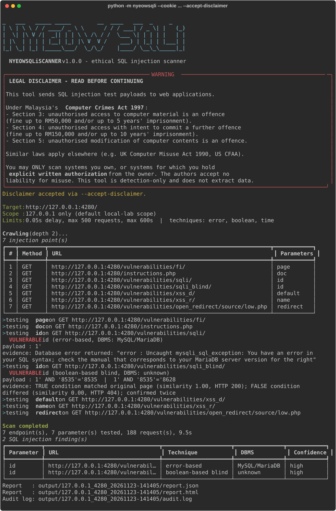
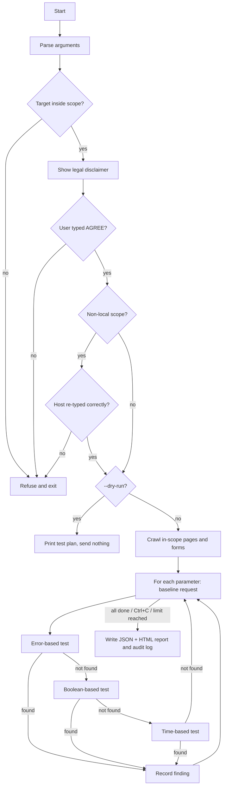
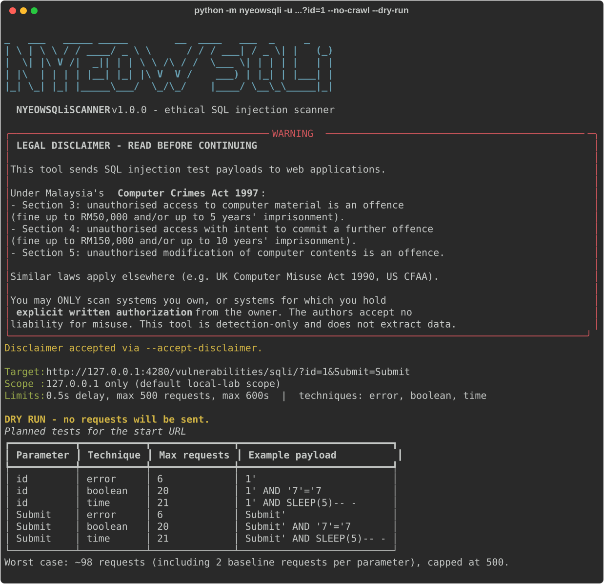
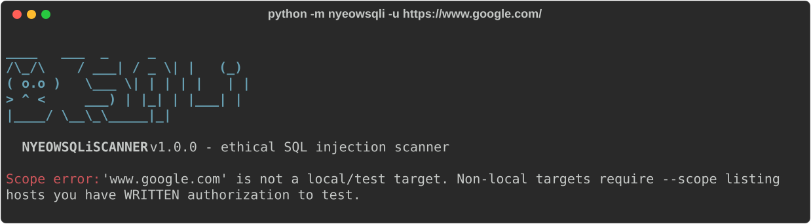
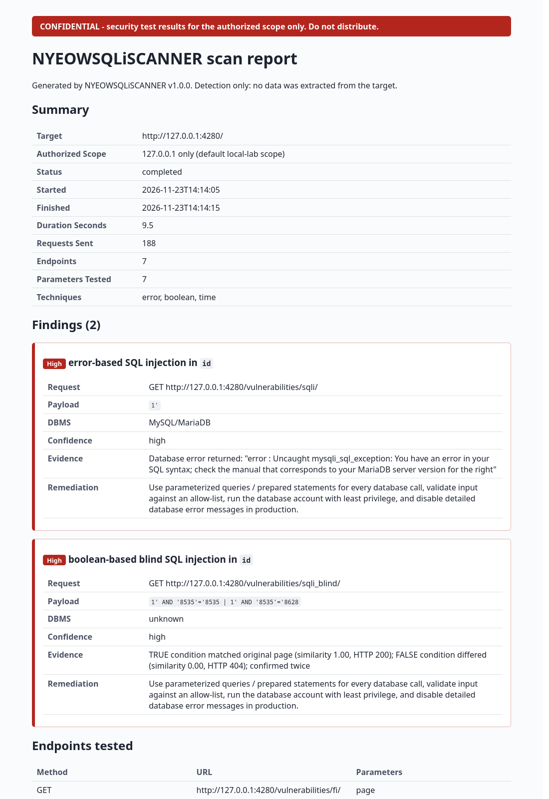

# NYEOWSQLiSCANNER

**A detection-only SQL injection scanner for authorized web application testing.**

NYEOWSQLiSCANNER crawls a web application inside a strictly enforced scope, discovers
injectable parameters (URL query strings and HTML forms), and tests each one with three
SQL injection detection techniques. It confirms whether a parameter is injectable and
fingerprints the database, **without extracting, modifying or deleting any data**.

| | |
|---|---|
| **Attack category** | Web Application Attack (SQL Injection, OWASP Top 10 A03:2021 - Injection, CWE-89) |
| **Language** | Python 3.10+ |
| **Interface** | Command line (`argparse` + `rich`) |
| **Output** | Terminal summary, JSON report, HTML report, request audit log |
| **Team** | NYEOWSQLiSCANNER |
| **License** | MIT |



---

## Table of contents
1. [Features](#features)
2. [How it works](#how-it-works)
3. [Attack lifecycle mapping](#attack-lifecycle-mapping)
4. [Installation](#installation)
5. [Setting up the test lab (DVWA)](#setting-up-the-test-lab-dvwa)
6. [Usage](#usage)
7. [Output and data handling](#output-and-data-handling)
8. [Ethical considerations](#ethical-considerations)
9. [Rules of Engagement (RoE)](#rules-of-engagement-roe)
10. [Responsible disclosure](#responsible-disclosure)
11. [Legal disclaimer](#legal-disclaimer)
12. [Limitations](#limitations)
13. [Project structure](#project-structure)

---

## Features

**Detection**
- **Error-based detection**: injects syntax-breaking characters and matches the response
  against 20+ database error signatures. Also fingerprints the DBMS (MySQL/MariaDB,
  PostgreSQL, Microsoft SQL Server, SQLite, Oracle).
- **Boolean-based blind detection**: sends an always-TRUE and an always-FALSE condition
  with random numbers and compares both against the original page using a similarity
  ratio. The threshold adapts to how "noisy" each page naturally is, and every hit must
  repeat in a second confirmation round.
- **Time-based blind detection**: asks the database to sleep and confirms with a
  three-step check (`SLEEP(d)` slow → `SLEEP(0)` fast → `SLEEP(d)` slow again), so a
  slow network is not mistaken for a vulnerability.
- **Baseline comparison**: every technique compares against the response to the
  original value, which removes false positives from pages that always look the same.

**Discovery**
- Breadth-first crawler for links and forms (GET by default, POST with `--post`).
- Session support via `--cookie` and custom headers via `-H`.

**Safety**
- Startup legal disclaimer (Computer Crimes Act 1997) with typed confirmation.
- Safe default target (`http://127.0.0.1/`, the local machine only).
- Scope enforcement on **every** request, including redirects and crawled links.
- Kill switch (Ctrl+C), request cap, time cap, rate limit and dry-run mode.
- Dangerous pages (logout, setup, reset, delete...) and password forms are never touched.

---

## How it works



Each module has one job:

| Module | Responsibility |
|---|---|
| `cli.py` | Arguments, validation, confirmation prompts, terminal output |
| `legal.py` | Banner and Computer Crimes Act disclaimer |
| `scope.py` | Decides which hosts may be contacted (hosts, `*.domain`, CIDR) |
| `http_client.py` | Every request: scope re-check, rate limit, budgets, audit log, kill switch |
| `crawler.py` | Finds injection points, skips unsafe pages and forms |
| `payloads.py` | Detection-only payloads and DB error signatures |
| `detectors.py` | Error-based, boolean-based and time-based detection logic |
| `scanner.py` | Runs the techniques over every parameter |
| `reporter.py` | Labelled JSON/HTML reports in the local output folder |

---

## Attack lifecycle mapping

| Phase | What NYEOWSQLiSCANNER does | Module |
|---|---|---|
| **1. Reconnaissance** | Crawls the in-scope application, follows links, reads HTML forms | `crawler.py` |
| **2. Scanning & enumeration** | Lists every injectable parameter (GET/POST), records skipped unsafe endpoints | `crawler.py` |
| **3. Vulnerability analysis** | Error, boolean and time-based tests against a baseline; DBMS fingerprinting | `detectors.py` |
| **4. Exploitation (gaining access)** | **Proof of concept only**: proves the injection with a harmless condition or delay. It deliberately stops here and does **not** dump data or run UNION queries | `detectors.py` |
| **5. Maintaining access** | **Not implemented, by design.** No shells, backdoors or persistence | - |
| **6. Covering tracks** | **Not implemented, by design.** The opposite: every request is written to an audit log and identified by its User-Agent | `http_client.py` |
| **7. Reporting** | JSON + HTML report with evidence, confidence, DBMS and remediation advice | `reporter.py` |

---

## Installation

Requirements: Python 3.10 or newer, Git, and Docker (for the test lab).

```bash
git clone https://github.com/eruwu03/nyeow-sqli-scanner.git
cd nyeow-sqli-scanner
python -m venv venv
source venv/bin/activate          # Windows: venv\Scripts\activate
pip install -r requirements.txt
python -m nyeowsqli --help
```

---

## Setting up the test lab (DVWA)

Only scan your own lab. The official DVWA Docker setup listens on `127.0.0.1:4280`,
so pass `-u http://127.0.0.1:4280/` (the tool's default is `http://127.0.0.1/`, port 80).

```bash
git clone https://github.com/digininja/DVWA.git
cd DVWA
docker compose up -d
```

1. Open <http://127.0.0.1:4280>, click **Create / Reset Database**, then log in with
   `admin` / `password`.
2. Open your browser's developer tools (F12) → Storage/Application → Cookies and copy the
   `PHPSESSID` value.
3. Pass it to the scanner together with the security level:
   `--cookie "PHPSESSID=<value>; security=low"`.

Vulnerable pages to expect: `/vulnerabilities/sqli/` (error-based) and
`/vulnerabilities/sqli_blind/` (boolean and time-based).

---

## Usage

```text
python -m nyeowsqli [-u URL] [--scope SCOPE] [--cookie COOKIE] [-H 'Name: value']
                    [--depth N] [--no-crawl] [--post] [--exclude REGEX]
                    [--techniques error,boolean,time] [--time-delay SEC]
                    [--delay SEC] [--max-requests N] [--max-time SEC] [--timeout SEC]
                    [--dry-run] [--accept-disclaimer]
                    [-o DIR] [--format json,html] [-v] [--no-color] [--version]
```

| Option | Default | Description |
|---|---|---|
| `-u, --url` | `http://127.0.0.1/` | Start URL |
| `--scope` | target host only | Authorized hosts, `*.domain` or CIDR ranges (required for non-local targets) |
| `--cookie` | none | Session cookie string |
| `-H, --header` | none | Extra header, repeatable |
| `--depth` | `2` | Crawl depth |
| `--no-crawl` | off | Test only the start URL |
| `--post` | off | Also test POST forms |
| `--exclude` | built-in list | Extra regex of URLs to skip |
| `--techniques` | all | `error`, `boolean`, `time` |
| `--time-delay` | `5` | Seconds used by time-based payloads (1-30) |
| `--delay` | `0.5` | Seconds between requests |
| `--max-requests` | `500` | Hard request cap |
| `--max-time` | `600` | Whole-scan time limit in seconds |
| `--dry-run` | off | Show the test plan without sending anything |
| `--accept-disclaimer` | off | Non-interactive authorization (lab use) |
| `-o, --output` | `output` | Output folder |
| `--format` | `json,html` | Report formats |

### Examples

```bash
# 1. Crawl and scan the local DVWA lab
python -m nyeowsqli -u http://127.0.0.1:4280/ --cookie "PHPSESSID=abc123; security=low"

# 2. Test a single URL without crawling
python -m nyeowsqli -u "http://127.0.0.1:4280/vulnerabilities/sqli/?id=1&Submit=Submit" \
    --cookie "PHPSESSID=abc123; security=low" --no-crawl

# 3. Only time-based detection on the blind page, 3-second delay
python -m nyeowsqli -u "http://127.0.0.1:4280/vulnerabilities/sqli_blind/?id=1&Submit=Submit" \
    --cookie "PHPSESSID=abc123; security=low" --no-crawl --techniques time --time-delay 3

# 4. Preview what would be sent, without sending anything
python -m nyeowsqli -u "http://127.0.0.1:4280/vulnerabilities/sqli/?id=1" --no-crawl --dry-run

# 5. Authorized non-local target (written permission required, interactive confirmation)
python -m nyeowsqli -u "https://staging.example.com/item?id=3" --scope staging.example.com
```

**Dry run**: shows the plan and request count, sends nothing:



**Scope enforcement**: a public target without `--scope` is refused before any request:



### Emergency stop
- **Ctrl+C once**: stops after the current request, saves a partial report marked
  `stopped: aborted by user`, exits with code 130.
- **Ctrl+C twice**: exits immediately.
- Automatic stop when `--max-requests` or `--max-time` is reached.

---

## Output and data handling

Every scan creates its own clearly labelled folder:

```
output/
└── 127.0.0.1_4280_20261123-141405/
    ├── report.json   # machine-readable findings
    ├── report.html   # human-readable report (labelled CONFIDENTIAL)
    └── audit.log     # every request: time, method, status, duration, URL
```



- **Nothing leaves your machine.** The tool has no upload, telemetry or "phone home" code.
- **No sensitive data is stored.** Reports hold only a short evidence snippet (max 300
  characters) per finding, never full response bodies. Cookies are never written to the
  reports or the audit log.
- **No data is extracted from the target.** The payloads only test conditions and delays.
- `output/` is in `.gitignore` so results cannot be committed by accident.
- Delete a scan folder once the findings have been handed to the system owner.

---

## Ethical considerations

Each guardrail exists for a specific reason:

| Guardrail | Why |
|---|---|
| **Legal disclaimer + typed `AGREE`** | Makes the user consciously confirm authorization. A non-interactive run refuses unless `--accept-disclaimer` is passed explicitly. |
| **Safe default target (127.0.0.1)** | Running the tool with no arguments can only hit the local lab. |
| **Default scope = the target host only** | Without `--scope`, the scan cannot wander to other machines, even other lab hosts. |
| **Non-local targets need `--scope` and the hostname re-typed** | A public target cannot be scanned by a typo or by copy-pasting a command. `--accept-disclaimer` cannot skip this step. |
| **Scope check on every request and redirect** | A crawled link or a `302` redirect cannot lead the scanner out of scope. |
| **Detection only (no UNION, no data dumping)** | The tool proves the risk without touching the data, so it is of little use to an attacker and safe for production-like targets. |
| **`AND SLEEP()` instead of `OR SLEEP()`** | `OR SLEEP()` sleeps once per row and could freeze a large table (accidental denial of service). |
| **Skips logout/setup/reset/delete pages and password forms** | Avoids destroying the session, resetting databases or changing passwords. |
| **POST forms off by default** | POST requests usually change server state (create, update, purchase). |
| **Rate limit, request cap, time cap** | Prevents overloading the target. |
| **Kill switch with partial report** | The tester can stop at any moment without losing evidence. |
| **Audit log + honest User-Agent** | Every action is traceable, and the target's defenders can identify the traffic as a security test. |
| **Dry-run mode** | Lets the tester and the system owner review what will be sent before anything is sent. |

---

## Rules of Engagement (RoE)

Before using NYEOWSQLiSCANNER against anything other than your own local lab, agree on
these rules **in writing** with the system owner.

### 1. Authorized scope
- **In scope**: only the hosts, domains or IP ranges written in the authorization letter
  and passed to `--scope`. For this project: `127.0.0.1` / `localhost` running DVWA.
- **Out of scope**: everything else, including third-party services, CDNs, payment
  providers, single sign-on providers and other tenants on shared hosting.
- Record the exact scope string used in each report (the tool does this automatically).

### 2. Time windows
- Scans only run during the window agreed with the owner, e.g.
  **Monday-Friday, 09:00-17:00 MYT**, or an agreed maintenance window for production.
- Use `--max-time` so a scan cannot overrun the window.
- Notify the owner's contact person before starting and after finishing each session.
- No testing during the owner's declared freeze periods (releases, exams, sales events).

### 3. Permitted techniques
- Crawling of in-scope pages.
- Error-based, boolean-based and time-based SQL injection **detection**.
- GET parameters; POST forms only when the owner explicitly allows them (`--post`).
- Request rate at or below the agreed limit (default 2 requests/second).

### 4. Prohibited actions
- Extracting, viewing, modifying or deleting any data (no UNION dumping, no stacked
  `INSERT`/`UPDATE`/`DELETE`/`DROP`).
- Denial-of-service, load testing, or raising `--max-requests` / lowering `--delay`
  beyond what was agreed.
- Testing out-of-scope hosts, or targets without written authorization.
- Using discovered vulnerabilities to pivot, escalate privileges or keep access.
- Social engineering, password attacks or any technique not listed above.
- Sharing results with anyone outside the agreed contact list.

### 5. Emergency stop procedure
1. Press **Ctrl+C** once; the scan stops and a partial report is saved.
2. If the tool does not respond, press **Ctrl+C** again (immediate exit) or close the terminal.
3. Immediately contact the system owner's emergency contact if the target shows
   instability (errors, slowness, outage) or if unexpected sensitive data appears.
4. Do not resume until the owner confirms it is safe.
5. Record what happened, using the `audit.log`, and include it in the final report.

---

## Responsible disclosure

If NYEOWSQLiSCANNER finds a vulnerability:

**Who to tell**
- The system owner or their designated security contact (check for
  `/.well-known/security.txt`, a bug bounty programme or a security email address).
- For third-party or open-source software: the vendor's security team or project maintainers.
- In Malaysia, if the owner cannot be reached or the issue affects many organisations:
  **MyCERT (CyberSecurity Malaysia)**, which coordinates vulnerability reports.

**When**
- Report **critical findings immediately** during an engagement (SQL injection is
  normally rated High/Critical).
- Give the owner reasonable time to fix before any public discussion. The common
  industry standard is **90 days**, extended if the owner is actively working on a fix.
- Never publish details of an unpatched vulnerability.

**How**
- Send the HTML/JSON report privately through an encrypted or agreed channel, never on
  public issue trackers or social media.
- Include: affected URL and parameter, technique, payload, evidence, date/time of the
  test (from `audit.log`) and the remediation advice in the report.
- State clearly that no data was extracted.
- Offer to re-test once the fix is deployed, then delete your copy of the results.

**Reporting a bug in this tool**: open an issue on this repository. For a security problem in
the tool itself, contact the maintainers privately first instead of opening a public issue.

---

## Legal disclaimer

> **This tool is for authorized security testing and education only.**
>
> Under Malaysia's **Computer Crimes Act 1997**, unauthorised access to computer material
> (Section 3), unauthorised access with intent to commit or facilitate a further offence
> (Section 4), and unauthorised modification of the contents of any computer (Section 5)
> are criminal offences punishable by fines and imprisonment. Similar laws exist in other
> countries, such as the UK Computer Misuse Act 1990 and the US Computer Fraud and Abuse Act.
>
> You may only use NYEOWSQLiSCANNER against systems you own or for which you hold
> **explicit written permission** from the owner. The authors accept no responsibility or
> liability for misuse or damage caused by this tool. The software is provided "as is",
> without warranty of any kind (see [LICENSE](LICENSE)).

---

## Limitations

- **Detection only**: confirms SQL injection but does not extract data. Use a dedicated
  tool under a separate authorization if exploitation is required.
- **Injection points**: GET parameters and form fields only. Cookies, HTTP headers, JSON
  bodies, and hidden form fields are not tested.
- **JavaScript-heavy apps**: the crawler reads static HTML and does not run JavaScript,
  so single-page applications may show few or no injection points.
- **Sessions**: if the session expires mid-scan (e.g. the app logs you out), later tests
  may silently see the login page. Use a fresh cookie for each scan.
- **WAFs**: no WAF evasion or payload obfuscation. Blocked payloads produce no finding.
- **Boolean-based detection** relies on the original value returning a result; a value
  that matches no record (e.g. `id=99999`) makes TRUE and FALSE look the same.
- **Time-based detection** can be affected by very unstable networks; the 3-step
  confirmation reduces but does not remove this.
- **DBMS coverage**: error signatures cover MySQL/MariaDB, PostgreSQL, MSSQL, SQLite and
  Oracle. Time-based payloads cover MySQL/MariaDB, PostgreSQL and MSSQL.
- **Single-threaded** by design (politeness and accurate timing), so large sites are slow.

---

## Project structure

```
nyeow-sqli-scanner/
├── nyeowsqli/
│   ├── __init__.py       # name and version
│   ├── __main__.py       # python -m nyeowsqli
│   ├── cli.py            # arguments, prompts, terminal output
│   ├── legal.py          # banner and disclaimer
│   ├── scope.py          # authorization scope
│   ├── http_client.py    # rate-limited, audited, scope-checked requests + kill switch
│   ├── crawler.py        # link and form discovery
│   ├── payloads.py       # payloads and DB error signatures
│   ├── detectors.py      # error / boolean / time-based detection
│   ├── scanner.py        # scan pipeline
│   └── reporter.py       # JSON and HTML reports
├── docs/screenshots/
├── requirements.txt
├── LICENSE
└── README.md
```

## License

Released under the [MIT License](LICENSE) by Team NYEOWSQLiSCANNER.
